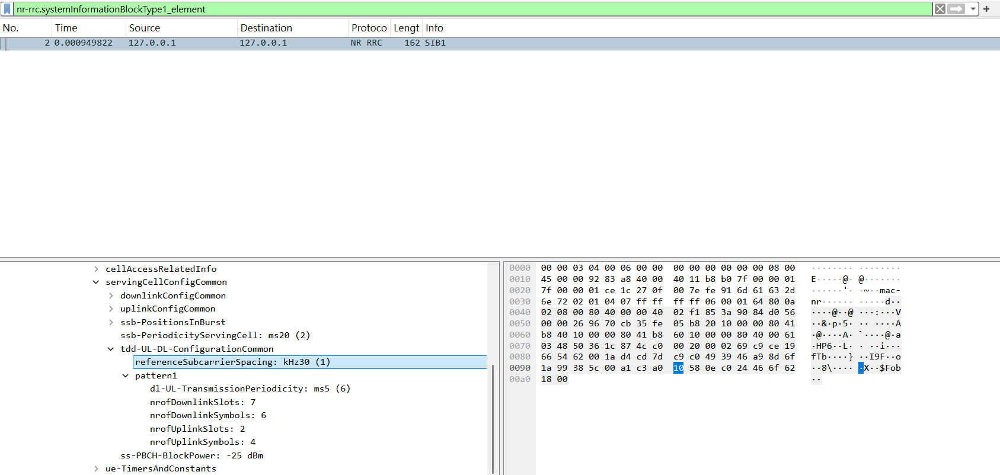
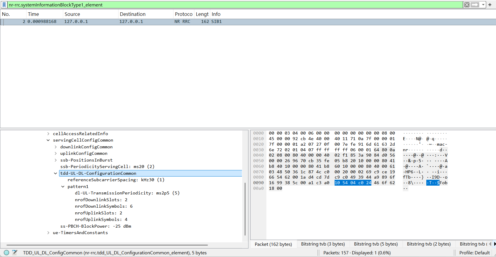
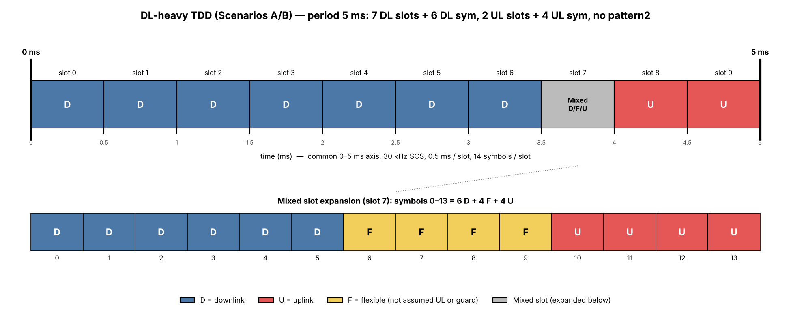
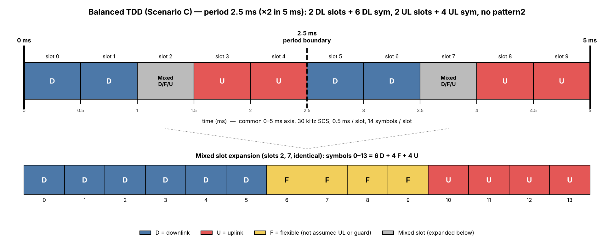
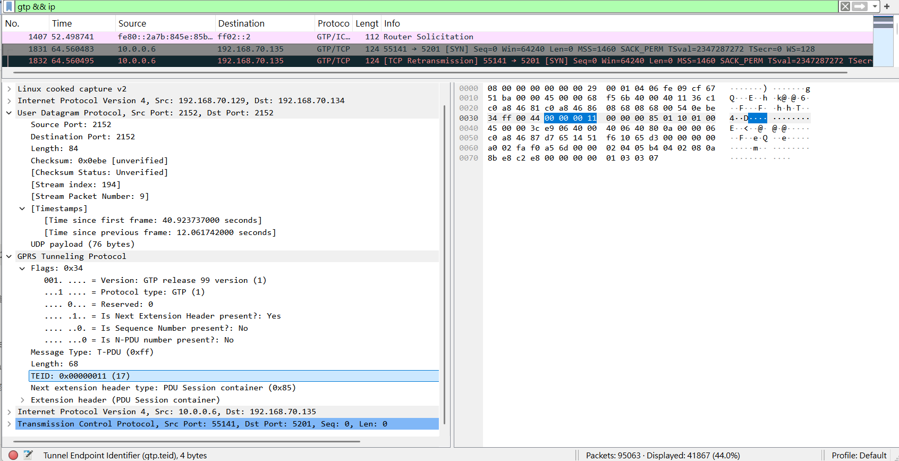
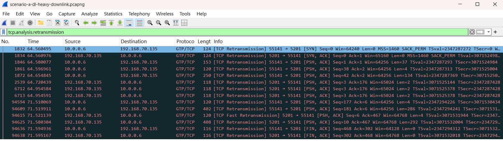
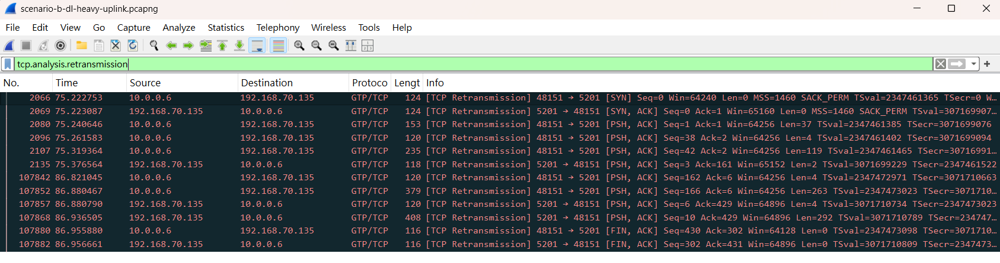
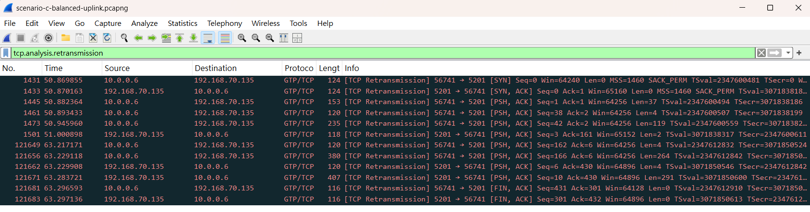

# Lab 2: gNB TDD Traffic Analysis

___

## 3. Task 1 — Confirm the Traffic Direction
* `reverse`: 1 means downlink in this lab.
* `reverse`: 0 means uplink in this lab.
* Complete the table:

| Scenario | Reverse value | Direction |
| -------- | -------- | -------- |
| A     | 1     | Downlink     |
| B     | 0     | Uplink     |
| C     | 0     | Uplink     |

* Question: Does the traffic direction shown in the JSON match the scenario description? Show the proof.

## 4. Task 2 — Compare Throughput
* In each JSON file, find:
```bash=
end → sum → bits_per_second
```
* Convert the value to Mbps:
```bash=
Throughput (Mbps) = bits_per_second ÷ 1,000,000
```

* Complete the table:

| Scenario |  Direction |Throughput (Mbps) |
| -------- | -------- | -------- |
| A     | Downlink   | 90654195.8358403 ÷ 1,000,000 = **90.65 Mbps** |
| B     |Uplink      | 109117249.69037457 ÷ 1,000,000 = **109.12 Mbps**     | 
| C     | Uplink     | 124416749.13023271 ÷ 1,000,000 = **124.42 Mbps**     | 

* Calculate how much C improves over B:
```bash=
Improvement (%) = (C - B) ÷ B × 100
```
* Answer:

1. What is the downlink throughput in Scenario A? **90.65 Mbps**
2. What is the uplink throughput in Scenario B? **109.12 Mbps**
3. Is the uplink throughput higher in B or C? **C > B**
4. By approximately what percentage does C improve over B? 
    * Improvement (%) = (124.42 - 109.12) ÷ 109.12 × 100 = **14.02%**

## 5. Task 3 — Check the Trade-off
* In each JSON file, find:
```bash=
end → sum → lost_percent
end → sum → jitter_ms
```

* Complete the table:

| Scenario |Throughput (Mbps) |Packet loss (%)|Jitter (ms)|
| -------- | -------- | -------- | -------- |
| B     | 109.12 | 0.236 | 0.116 |
| C     | 124.42 | 2.134 | 0.162 |

* Answer:

1. Does C have higher uplink throughput than B?
    *  Yes, C's throughput is 124.42 Mbps higher than B's 109.12 Mbps.
2. Does C have lower packet loss than B?
    *  No, C's packet loss is 2.134% higher than B's 0.236%.
3. What trade-off, if any, is visible when changing from B to C?
    * Compared with Scenario B, Scenario C has higher throughput (124.42 vs. 109.12 Mbps, +14.02%), higher packet loss (2.134% vs. 0.236%), and higher jitter (0.162 vs. 0.116 ms). These results suggest a trade-off between throughput and reliability in these tests: C delivers more uplink data, but a larger fraction of packets is lost and timing varies more.

## 6. Task 4 — Read SIB1 and Draw the TDD Configuration
### 4.3 Record the TDD Parameters

* Complete the table for pattern1:
 
| Item |DL-heavy: A/B |Balanced: C|
| -------- | -------- | -------- |
| Configuration capture filename     | tdd-dl-heavy-sib1.pcapng | tdd-balanced-sib1.pcapng |
| SIB1 packet number     | 2 | 2 |
| `referenceSubcarrierSpacing `(kHz)| 30 kHz | 30 kHz |
| `dl-UL-TransmissionPeriodicity` (ms) | 5 ms | 2.5 ms |
| `nrofDownlinkSlots` | 7 | 2 |
| `nrofDownlinkSymbols `  | 6 | 6 |
| `nrofUplinkSlots `  | 2 | 2 |
| `nrofUplinkSymbols`    | 4 | 4 |
| Is `pattern2` present? | No. | No. |
* DL-heavy: A/B

* Balanced: C


### 4.4 Draw the TDD Time Allocation

| Reference SCS | Reference slot duration |
| --- | --- |
| 30k Hz | 0.5 ms |

```bash=
Number of reference slots in a pattern = Pattern period ÷ Reference slot duration
```

```bash=
Configured DL symbols = 14 × Full DL slots + Partial DL symbols
Configured UL symbols = 14 × Full UL slots + Partial UL symbols
Flexible symbols = Total symbols - Configured DL symbols - Configured UL symbols
Configured UL symbol share (%) = Configured UL symbols ÷ Total symbols × 100
```

| TDD setting | Repeating duration (ms) | Total reference slots | DL symbols | UL symbols | Flexible symbols | UL share (%) |
| --- | --- | --- | --- | --- | --- | --- |
| DL-heavy | 5   | 10   | 104 | 32 | 4 | 22.857 |
| Balanced | 2.5 | 5   | 34 | 32 | 4 | 45.714  |

* Next, count the symbols over the **same 5 ms interval** shown in your diagrams.

| TDD setting | Repeating duration (ms) | Repetitions in 5 ms | DL in 5 ms | UL in 5 ms | Flexible in 5 ms |
| --- | --- | --- | --- | --- | --- |
| DL-heavy | 5   | 1   | 104   | 32   | 4   |
| Balanced | 2.5 | 2   | 68   | 64   | 8   |

* tdd_dl_heavy

* tdd_balanced


* **Question:** Can two patterns have the same UL symbol count per period but provide different numbers of UL symbols per unit time? Explain using your two tables.
    * Yes. Table 1 shows that both patterns have 32 UL symbols per period. However, their repeating durations differ (5 ms vs. 2.5 ms), so within the same 5 ms, the balanced pattern repeats twice while the DL-heavy pattern repeats only once. As a result, Table 2 shows 64 UL symbols per 5 ms for balanced vs. 32 for DL-heavy, twice as many.

### 4.5 Connect SIB1 to the Performance Results

| Scenario | Reference TDD setting | JSON traffic direction | Configured UL symbol share (%) | Throughput (Mbps) | Packet loss (%) |
| --- | --- | --- | --- | --- | --- |
| A   | DL-heavy | Downlink | 22.86 | 90.65  | 0.443 |
| B   | DL-heavy | Uplink | 22.86 | 109.12  | 0.236 |
| C   | Balanced | Uplink | 45.71 | 124.42  | 2.134 |

* Answer:

1.  Which decoded TDD parameters differ between DL-heavy and balanced?
    * The different parameters are `dl-UL-TransmissionPeriodicity` (ms), and `nrofDownlinkSlots` .
2.  Which configuration provides more configured UL symbols per unit time? Support your answer with the diagram and calculated share.
    * **Balanced.** Both patterns have 32 UL symbols per period, but the balanced period is 2.5 ms instead of 5 ms, so it repeats twice in 5 ms. The diagram shows two UL segments in 0–5 ms for balanced versus one for DL-heavy, giving 64 vs. 32 UL symbols per 5 ms. The configured UL share is also higher: 45.71% vs. 22.86%.

3.  How does that difference help explain the B/C throughput comparison?
    * 109.12 → 124.42 Mbps (+14.02%). Because C has more UL symbols per 5 ms than B (64 vs. 32), the UE gets more chances to transmit in the uplink. Therefore, its uplink throughput is higher than B’s.

4.  Why can A and B use the same SIB1 TDD configuration even though their traffic directions differ?
    * SIB1 is broadcast by the gNB to the whole cell, and its TDD pattern contains both DL and UL time slots. Which direction the traffic goes is decided by the application (iperf3 reverse = 1 or 0), not by SIB1. So A and B can run on the same TDD configuration: A uses the DL slots and B uses the UL slots. However, using the same configuration does not mean it suits both directions equally. B gets far fewer UL resources (22.86%).

## Task 5 — Is the TDD Setting Suitable?

* Complete the table using the supplied scenario mapping, the SIB1 reference configurations from Task 4, and your throughput results:

| Scenario | TDD setting | Traffic direction | Is the setting suitable for this direction? Why? |
| --- | --- | --- | --- |
| A   | DL-heavy | Downlink | Suitable. It uses most of the symbols (104/140, 74.3%) for DL, which matches downlink traffic.  |
| B   | DL-heavy | Uplink | Unsuitable. Only 32/140 symbols (22.86%) are UL, and UL opportunities come only once every 5 ms, so heavy uplink traffic has to wait.    |
| C   | Balanced | Uplink | More suitable than B. UL share is 45.71% (64 UL symbols per 5 ms vs. 32), with an UL opportunity every 2.5 ms, which fits uplink traffic better. The trade-off is less DL capacity. |

* **Question:** Why might Scenario C achieve better uplink throughput than Scenario B? Refer to your SIB1 diagrams and measured results.
    * Because in 5ms, C's UL share (%) are higher than B's (45.714 > 22.857)

## Task 6 — Find GTP-U Information

* Open a **scenario capture** in Wireshark and enter this display filter:

```text
gtp && ip
```

Choose a packet that contains two IPv4 headers. In the packet details, expand:

1. the first `Internet Protocol Version 4` header;
2. `User Datagram Protocol`;
3. `GPRS Tunneling Protocol`; and
4. the second `Internet Protocol Version 4` header.

Record the following information from one packet:

| Item | Value |
| --- | --- |
| Scenario capture filename |scenario-a-dl-heavy-downlink.pcapng |
| Packet number | 1831 |
| Outer source IP | 192.168.70.129 |
| Outer destination IP | 192.168.70.134 |
| Inner source IP | 10.0.0.6 |
| Inner destination IP | 192.168.70.135 |
| TEID | 0x00000011 (17) |

Meaning:

- **Outer IP addresses:** The GTP-U tunnel endpoints.
- **Inner IP addresses:** The original UE/application packet.
- **TEID:** Identifies the GTP-U tunnel at the receiving endpoint.



## 9. Task 7 — TCP Retransmissions

Use the **scenario captures** for this task.

The performance traffic is UDP, but iperf3 also uses a small TCP control connection.

Apply this Wireshark filter:

```text
tcp.analysis.retransmission
```

Record the number of displayed packets:

| Scenario | Displayed TCP retransmissions |
| --- | ---: |
| A | 14 |
| B | 12 |
| C | 12 |

* scenario-a-dl-heavy-downlink.pcapng

* scenario-b-dl-heavy-uplink.pcapng

* scenario-c-balanced-uplink.pcapng


* **Question:** Do these TCP retransmissions directly represent lost UDP performance packets?
    * No. TCP retransmissions and UDP packet loss are two different concepts.
        1.  These packets belong to the iperf3 TCP control connection, not the UDP test traffic. UDP does not retransmit lost packets; packet loss is counted by iperf3 using its own sequence numbers.
        2.  In general, a high TCP retransmission count indicates packet loss in the network, and repeated retransmissions can greatly reduce TCP throughput.
        3.  In this capture, however, most flagged packets are the same packet captured twice by Wireshark (e.g., 6712 → 6713: 7 µs apart with the same TSval), not real losses.


## 10. Task 8 — RTT and Packet Interval

Use a **scenario capture** for both parts of this task.

### TCP RTT

Apply:

```text
tcp.analysis.ack_rtt
```

Select one packet from the iperf3 TCP control connection and record its ACK RTT:

| Scenario | Packet number | Example TCP ACK RTT |
| --- | ---: | --- |
| C | 1441 | 11.405 ms |

This value is the RTT of the TCP control connection. It is not the RTT of the UDP data packets.


### Packet Interval

Apply a display filter to select UDP data packets from the same flow.

Select two consecutive, distinct UDP data packets in the filtered packet list. Avoid duplicated observations caused by merged captures; use the same capture point/interface when possible.

In the packet details of the second packet, find:

```text
Time delta from previous displayed frame
```

Record the scenario, display filter, packet numbers, and time interval.

| Scenario | Display filter | Packet numbers | Time interval |
| --- | --- | --- | --- |
| C | ip.dst == 192.168.70.134 && frame.len == 1520 && sll.ifindex == 41 | 1556 & 1562 | 2.800 ms |


* 51.037053 − 51.034253 = 0.002800 s = **2.800 ms**

## 11. Final Questions

Answer each question in two or three sentences:

1. Does Scenario A use a TDD setting that matches its traffic direction?
    * Yes. The DL-heavy pattern gives most of the symbols to DL (104/140 = 74.29%). A achieved 90.65 Mbps with only 0.443% loss.
2. Why is Scenario B expected to have limited uplink resources? Cite a parameter or count from the DL-heavy SIB1 reference configuration.
    * Only 32/140 symbols (22.86%) can transmit UL data in per 5 ms period, so it will be limited uplink resources.
3. How much does uplink throughput change from B to C?
    * B change to C is 109.12 → 124.42 Mbps (+14.02%), 124.42 - 109.12 = ==15.3 Mbps==
4. What negative result, if any, is visible in C? Support your answer with packet loss or jitter values.
    * C’s packet loss (2.134%) and jitter (0.162 ms) are both higher than B’s (0.236% and 0.116 ms). Packet loss is about 9 times higher, so a larger fraction of C’s data is lost.
5. Why can increasing UL resources improve uplink throughput?
    * Because it increases the number of UL symbols per unit time (64 vs. 32 per 5 ms)
6. Is adding more UL resources always the best solution? Explain using throughput and packet loss.
    * No. From B to C, throughput increases by 14% (109.12 → 124.42 Mbps), but packet loss also rises from 0.236% to 2.134% (about 9×).
7. Suggest one simple follow-up test that could improve throughput without producing too much packet loss.
    * Repeat the UDP test with `iperf3 -u -b` at lower sending rates (e.g., 40, 60, 80 Mbps) and find the highest rate with packet loss below 1%. In B and C the sender pushed data faster than the uplink could deliver, so a lower rate should reduce loss.
8. What can the configuration captures tell you that the iperf3 JSON cannot? Why are separately recorded configuration captures not direct proof of the configuration during an earlier test?
    * The SIB1 captures show the TDD settings (periodicity, DL/UL slots and symbols), while the iperf3 JSON only shows throughput, loss and jitter. 
    * However, the SIB1 captures were recorded separately from tests A–C. They only prove the configuration at capture time, not during the tests.


		


