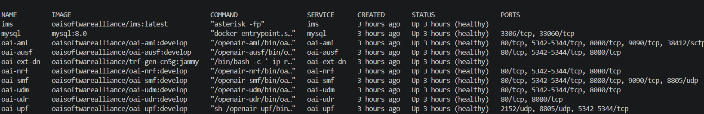
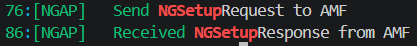
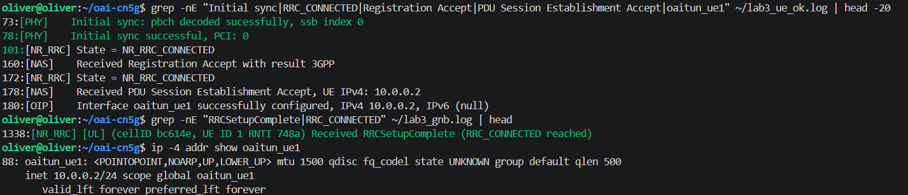
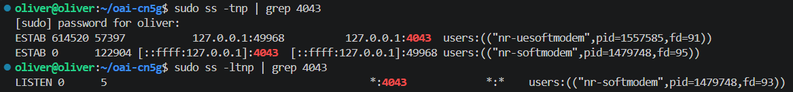
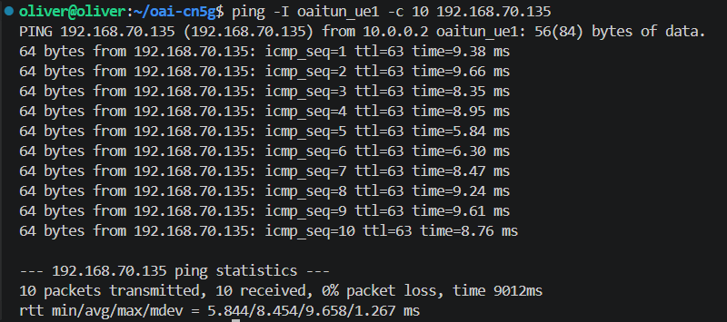
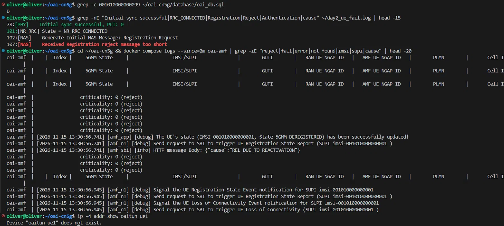
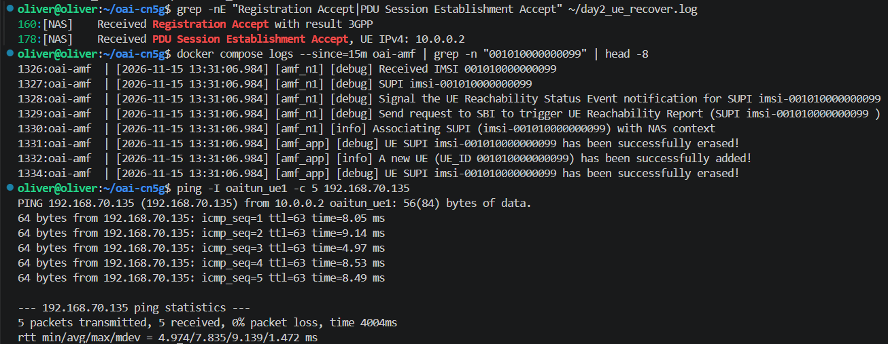

# Lab 3: Deploying a 5G Standalone Network Using OpenAirInterface

___

:::spoiler 目錄 : 
 [toc] 
:::
___

## Task 1 — Verify the 5G SA Connection

Start the OAI CN5G:

```bash
cd ~/oai-cn5g
docker compose up -d
docker compose ps
```

Start the gNB and nrUE using the commands in the Build Guide.

| Stage | Successful? | Evidence from logs |
|---|---|---|
| CN5G initialization | Yes | `docker compose ps`: all 10 containers are `Up (healthy)` |
| gNB NG Setup | Yes | gNB log L76 `[NGAP] Send NGSetupRequest to AMF` → L86 `[NGAP] Received NGSetupResponse from AMF` |
| UE synchronization | Yes | UE log L78 `[PHY] Initial sync successful, PCI: 0` |
| RRC connection establishment | Yes | UE log L101 `[NR_RRC] State = NR_RRC_CONNECTED`; gNB log L1338 `Received RRCSetupComplete (RRC_CONNECTED reached)` |
| UE Registration | Yes | UE log L160 `[NAS] Received Registration Accept with result 3GPP` |
| PDU Session Establishment | Yes | UE log L178 `[NAS] Received PDU Session Establishment Accept, UE IPv4: 10.0.0.2` |
| UE tunnel creation | Yes | UE log L180 `[OIP] Interface oaitun_ue1 successfully configured, IPv4 10.0.0.2` |








1. Does a successful NG Setup guarantee that a UE can register? Explain.

No. NG Setup is the N2 interface setup between the gNB and the AMF. It only shows that the gNB itself has been accepted by the core network, and it is not tied to any specific UE. Whether a UE can register depends on its own NAS procedures: the IMSI must be provisioned in the UDM/UDR, the authentication keys must be correct, 5G-AKA authentication and the Security Mode procedure must succeed, and the requested PLMN and NSSAI must be allowed. A successful NG Setup is therefore a necessary condition for UE registration, but not a sufficient one.

2. Why can the UE establish an RRC connection but still fail Registration?

RRC and Registration belong to different layers. The RRC connection is an Access Stratum procedure between the UE and the gNB; the gNB only manages radio resources and does not check the UE's identity or subscription data. Registration is a NAS procedure between the UE and the AMF, and the AMF verifies the subscriber through the AUSF and UDM. If the IMSI is not provisioned, the keys are wrong, or the PLMN/NSSAI is not allowed, the UE can reach RRC_CONNECTED but still be rejected or fail authentication at the NAS layer.

3. What additional procedure is required after Registration before user data can be exchanged?

A PDU Session Establishment procedure is required. Registration only makes the UE known to the core network on the control plane; no user-plane path exists yet. After the UE sends a PDU Session Establishment Request, the SMF selects a UPF and assigns the UE an IP address (10.0.0.2 in this lab). The gNB sets up a DRB and an N3 GTP-U tunnel to the UPF, and the UE creates the oaitun_ue1 interface. Only then can data flow along UE → gNB → UPF → DN. In this lab, UE log lines L178 and L180 correspond to this procedure.

Task 2 — Inspect RFsimulator over TCP
---

```bash
pgrep -a nr-softmodem
pgrep -a nr-uesoftmodem
sudo ss -tnp | grep 4043
sudo ss -ltnp | grep 4043   # 看 gNB 的 LISTEN socket
```

| Item | Observed Value |
|---|---|
| gNB process ID | 1479748 |
| nrUE process ID | 1557585 |
| RFsimulator transport protocol | TCP |
| RFsimulator port | 4043 |
| TCP connection state | ESTAB (gNB also LISTEN on *:4043) |
| Connected process(es) | nr-uesoftmodem 127.0.0.1:49968 ↔ nr-softmodem 127.0.0.1:4043 |



**Questions:**

1. Why does RFsimulator use a TCP connection instead of a physical antenna?

RFsimulator replaces the radio front end with software so that the gNB and UE can run on one machine without any RF hardware. Instead of sending signals through a DAC, antenna and the air, the gNB acts as a TCP server on port 4043, and the UE connects to it as a client. The two processes exchange baseband IQ samples over this socket. TCP provides a reliable, ordered byte stream on the loopback interface, which makes it a simple way to pass sample streams between two processes.

2. Are the TCP packets exchanged by RFsimulator the same as the UE's application-layer IP packets?

No. The RFsimulator TCP stream carries time-domain IQ samples, which sit below the 5G physical layer. The UE's application IP packets (for example, Ping from 10.0.0.2) first enter oaitun_ue1. They are then processed by SDAP, PDCP, RLC, MAC and PHY, and modulated into OFDM IQ samples, and only then are these samples carried inside the TCP stream. The TCP connection is between 127.0.0.1:49968 and 127.0.0.1:4043, while the UE's IP address 10.0.0.2 never appears in it.

3. Does using RFsimulator mean that the UE and gNB are performing no physical-layer processing? Explain.

No. RFsimulator only replaces the RF hardware and the wireless channel. The gNB and UE still perform full NR physical-layer processing, including channel coding (LDPC/Polar), modulation, OFDM (IFFT/FFT), SSB/PBCH generation and detection, synchronization and HARQ. The UE log shows this: "Initial sync: pbch decoded successfully" and "Initial sync successful, PCI: 0" are physical-layer results. Only the step of transmitting the samples over the air is replaced by TCP.


Task 3 — End-to-end connectivity
---

```bash
ip -4 addr show oaitun_ue1
ping -I oaitun_ue1 -c 10 192.168.70.135
```

| Measurement | Observed Value |
|---|---|
| UE IP address | 10.0.0.2 |
| Destination IP | 192.168.70.135 |
| Packets transmitted | 10 |
| Packets received | 10 |
| Packet loss (%) | 0 |
| Minimum RTT (ms) | 5.844 |
| Average RTT (ms) | 8.454 |
| Maximum RTT (ms) | 9.658 |



**Questions:**

1. Why must Ping use the oaitun_ue1 interface in this experiment?

The UE, gNB and core network all run on the same host, and the host itself can reach 192.168.70.135 directly through the Docker bridge network. Without -I oaitun_ue1, Ping would use the host's normal routing table and bypass the 5G system entirely. Binding Ping to oaitun_ue1 forces packets to use the UE's PDU session address (10.0.0.2), so they travel through the NR protocol stack, RFsimulator, the gNB, the N3 GTP-U tunnel and the UPF before reaching the DN.

2. Does successful Registration guarantee successful user-plane connectivity?

No. Registration only completes the control-plane procedure between the UE and the AMF. User-plane connectivity additionally requires a successful PDU Session Establishment (SMF selects a UPF and assigns an IP address), a DRB set up by the gNB, an N3 GTP-U tunnel to the UPF, a correctly configured oaitun_ue1 interface, and correct routing from the UPF to the DN. A failure in any of these steps would break data transfer even though the UE is registered.

3. What does a successful Ping prove, and what does it not prove about the simulated 5G system?

It proves that the complete path UE → gNB → UPF → DN works in both directions: the PDU session, DRB, GTP-U tunnel, UPF forwarding and the DN route are all functional, with 0% loss and an average RTT of 8.454 ms. It does not prove anything about real radio performance. RFsimulator has no real wireless channel, RF impairments, interference or mobility, and all components run on one host, so the measured RTT mainly reflects software processing and scheduling rather than over-the-air 5G latency. It also does not show throughput, stability under load, or behaviour with multiple UEs.

## Task 4 — Investigate the Effect of Packet Size

You will now investigate whether changing the ICMP packet size affects the observed RTT.

Perform three experiments using the same established 5G connection.

**Scenario A — Small Packets**

```bash
ping -I oaitun_ue1 -s 56 -c 30 -i 0.2 192.168.70.135
```

**Scenario B — Medium Packets**

```bash
ping -I oaitun_ue1 -s 512 -c 30 -i 0.2 192.168.70.135
```

**Scenario C — Large Packets**

```bash
ping -I oaitun_ue1 -s 1200 -c 30 -i 0.2 192.168.70.135
```

Note: `-s` specifies ICMP payload size, not the complete IP packet size.

Complete the table:
| Scenario | ICMP Payload | Avg. RTT (ms) | Max. RTT (ms) | Packet Loss (%) |
|---|---:|---:|---:|---:|
| A | 56 bytes | 8.247 | 9.388 | 0 |
| B | 512 bytes | 8.689 | 10.190 | 0 |
| C | 1200 bytes | 9.837 | 11.355 | 0 |

```text
RTT Difference = Average RTT(C) - Average RTT(A)
               = 9.837 - 8.247
               = 1.590 ms
```

1. Which scenario has the highest average RTT?

Scenario C (1200-byte payload) has the highest average RTT at 9.837 ms, which is 1.590 ms higher than Scenario A (8.247 ms). It also has the highest maximum RTT (11.355 ms) and the highest minimum RTT (7.107 ms).

2. Does increasing packet size always increase RTT in your measurements?

In this run the average RTT increased with packet size (8.247 → 8.689 → 9.837 ms), and the maximum RTT followed the same trend. However, the increase is not strictly consistent at the per-packet level: the minimum RTT of Scenario B (5.421 ms) is lower than that of Scenario A (5.861 ms), and the standard deviation (mdev 0.945–1.339 ms) is close to the A–B difference of only 0.442 ms. This means the trend between A and B is within normal variation, and a repeated measurement could show a different order. Only the difference to Scenario C is clearly larger than the variation.

3. Why might a larger packet require more transmission or processing resources?

A larger packet produces a larger transport block, so the MAC scheduler must allocate more PRBs or more slots, and the UE may need more than one uplink grant to send it. Every layer (PDCP, RLC, MAC, PHY) also has more data to process: more LDPC code blocks to encode and decode, more symbols to modulate and demodulate, and more IQ samples to pass over the RFsimulator socket. The packet also has to be copied and encapsulated in GTP-U at the gNB and UPF. All of this adds processing time in both directions of the Ping.

4. What factors other than packet size could affect RTT in a software-based 5G network?

Uplink scheduling is an important factor: the UE has to send a Scheduling Request or BSR and wait for an uplink grant, and settings such as min_rxtxtime and the TDD pattern decide how long it waits for an uplink slot. CPU load and OS scheduling of the gNB, UE and core network processes also matter, since they all run on the same host. Other factors include HARQ timing, Docker networking and UPF forwarding, the RFsimulator socket buffering, and background processes on the machine.

5. Can these results be interpreted as real over-the-air 5G latency? Explain.

No. RFsimulator sends IQ samples over a local TCP socket instead of through antennas and a radio channel, so there is no real propagation, fading, interference or RF hardware delay. Timing is driven by the exchange of samples between software processes rather than by a real-time radio clock, and the gNB, UE and core all run on one host without fronthaul or backhaul. The measured 8–10 ms RTT therefore mainly reflects software processing and scheduling in this specific setup, and it can only be used for relative comparison within this environment.


## Task 5 — Diagnose a Controlled UE Registration Failure

| Item | Observation |
|---|---|
| Modified parameter | `--uicc0.imsi` changed from 001010000000001 to 001010000000099 (not in `oai_db.sql`: `grep -c` returned 0) |
| UE synchronized with gNB? | Yes, UE log L78 `Initial sync successful, PCI: 0` |
| RRC connection established? | Yes, UE log L101 `State = NR_RRC_CONNECTED` |
| Registration successful? | No, `oaitun_ue1` was not created (`Device "oaitun_ue1" does not exist`) |
| Error or rejection evidence | UE log L102 `Generate Initial NAS Message: Registration Request` → L107 `Received Registration reject message too short`; AMF log 13:31:06.984 `Received IMSI 001010000000099` → `Associating SUPI (imsi-001010000000099) with NAS context` → `UE SUPI imsi-001010000000099 has been successfully erased!` |
| Likely cause | The IMSI is not provisioned in the subscriber database, so the core network has no subscription or authentication data for this SUPI and rejects the registration |

Failed connection (IMSI 001010000000099):



Recovered connection (IMSI 001010000000001):



1. Why can the UE potentially synchronize with the gNB even when the IMSI is incorrect?

Synchronization and RRC setup are handled between the UE and the gNB at the physical and RRC layers, and they only depend on radio parameters such as band, frequency, numerology and bandwidth. The gNB broadcasts SSB and system information to any UE and does not check the UE's subscription. The IMSI is only used later in NAS signalling with the AMF. This matches the logs: with the wrong IMSI, the UE still reached `Initial sync successful` (L78) and `NR_RRC_CONNECTED` (L101).

2. Which network function is involved in UE authentication?

The AMF starts authentication and acts as the SEAF, the AUSF performs the 5G-AKA authentication, and the UDM, using subscription data stored in the UDR (the MySQL database in OAI CN5G), provides the authentication vectors and resolves the SUCI to the SUPI. Because IMSI 001010000000099 is not stored in the UDR, the core network cannot authenticate this UE.

3. Why does changing an IMSI affect Registration but not the RFsimulator TCP connection itself?

The RFsimulator TCP connection only carries IQ samples between the nrUE and gNB processes on port 4043, and it depends on `--rfsimulator.serveraddr` and the port, not on the UE's identity. The IMSI is a NAS-layer identity that is only checked by the AMF, AUSF and UDM during Registration. Changing the IMSI therefore leaves the TCP connection, synchronization and RRC unchanged, while Registration fails.

4. What evidence proves that restoring the correct configuration solved the problem? Submit evidence from both the failed and recovered connections.

With IMSI 001010000000099, the UE received a Registration Reject (L107), the AMF erased the UE context, and `oaitun_ue1` did not exist. After restoring IMSI 001010000000001 without restarting CN5G or the gNB, the UE log shows `Received Registration Accept with result 3GPP` (L160) and `Received PDU Session Establishment Accept, UE IPv4: 10.0.0.2` (L178). `oaitun_ue1` was recreated with 10.0.0.2/24, and a Ping to 192.168.70.135 succeeded with 5/5 packets received, 0% loss and an average RTT of 7.835 ms. Since only the IMSI was changed, this shows the failure was caused entirely by the unprovisioned subscriber identity.

---

## Task 7 — Explain the Relationship Between Simulation and Real 5G

| Feature | OAI RFsimulator | Physical 5G System |
|---|---|---|
| gNB and UE protocol stack | Yes, full NR stack (SDAP/PDCP/RLC/MAC/PHY, RRC, NAS) | Yes |
| OFDM signal processing | Yes, IQ samples generated and decoded in software | Yes |
| Physical antennas | No, IQ samples sent over TCP port 4043 | Yes |
| RF hardware impairments | Not inherently (no CFO, phase noise, IQ imbalance, PA nonlinearity) | Yes |
| Wireless propagation effects | Not inherently (ideal channel unless a channel model is configured) | Yes (path loss, fading, multipath, interference) |
| 5G Core connectivity | Yes, OAI CN5G via N2/N3 | Yes |

1. Which parts of the 5G system remain functional when physical RF hardware is replaced with RFsimulator?

Everything except the RF front end and the air interface remains functional. The gNB and UE still run the complete NR protocol stack, including baseband PHY processing (channel coding, modulation, OFDM, synchronization, HARQ), MAC scheduling, RLC, PDCP, SDAP, RRC and NAS. The 5G Core still performs NG Setup, Registration, authentication and PDU Session Establishment, and user data still flows through the N3 GTP-U tunnel and the UPF to the DN. Only the transmission of IQ samples through DAC/ADC, antennas and the air is replaced by a TCP socket.

2. Why is RFsimulator useful for testing the 5G protocol stack?

It allows the full end-to-end 5G SA system to run on a single computer without USRPs, antennas or a spectrum license, which makes it cheap and easy to set up. Because the channel is ideal and repeatable, failures can be attributed to the protocol stack or configuration rather than to radio conditions. It is therefore well suited for functional testing, debugging signalling procedures, teaching, and developing new features before moving to real hardware.

3. Why might latency and throughput differ between RFsimulator and a real 5G deployment?

In RFsimulator, timing is driven by the exchange of samples between processes rather than by a real-time hardware clock, so latency and throughput depend mainly on CPU speed, OS scheduling and system load. There is no real channel, so there are no retransmissions caused by fading or interference, and no link adaptation to poor signal conditions. All components also run on one host, so there is no fronthaul, backhaul or transport delay. A real deployment adds air-interface timing, channel impairments, radio hardware latency and network transport delay.

4. What would need to change if you wanted to test a physical UE instead of OAI nrUE?
The gNB would need real RF hardware, such as a USRP B210 with suitable antennas, and would be started without --rfsim using a configuration that matches the hardware. The frequency band and bandwidth would have to be supported by the commercial UE and legally usable, typically in a shielded box or under a test license. The UE would need a programmable SIM whose IMSI, K and OPc are provisioned in the CN5G subscriber database, and the PLMN, NSSAI and DNN would need to match the SIM and the UE's APN settings. Time synchronization and real-time performance of the host would also become important.

## Final Analysis

1. Describe the complete process from starting the OAI 5GC to successful user-plane connectivity.

First, the OAI CN5G network functions (NRF, AMF, SMF, UPF, AUSF, UDM, UDR and MySQL) were started with Docker Compose, and all containers became healthy. The gNB then sent an NGSetupRequest to the AMF over N2 and received an NGSetupResponse, while also listening on TCP port 4043 as the RFsimulator server. The nrUE connected to this port, achieved initial synchronization (PCI 0), completed the RRC setup to reach RRC_CONNECTED, and registered with the AMF through NAS, receiving a Registration Accept. Finally, a PDU Session Establishment assigned the UE the IP address 10.0.0.2, the GTP-U tunnel to the UPF was set up, the oaitun_ue1 interface was created, and a Ping to 192.168.70.135 succeeded with 0% packet loss.

2. Explain the difference between an RFsimulator TCP connection and a 5G PDU Session.

The RFsimulator TCP connection (127.0.0.1:49968 ↔ 127.0.0.1:4043) is a local socket between the nrUE and gNB processes that replaces the radio hardware and carries baseband IQ samples below the physical layer. A PDU Session is a 3GPP logical connection set up by the SMF that carries the UE's IP traffic from the UE through a DRB, the gNB and the N3 GTP-U tunnel to the UPF and the data network. The two are at completely different layers: the UE's IP packets (from 10.0.0.2) are processed by the NR protocol stack and turned into IQ samples, which are then carried inside the TCP stream. The TCP connection can therefore exist even when no PDU Session has been established, as seen in the registration failure test.

3. Based on your measurements, how did packet size affect RTT and packet loss?

The average RTT increased slightly with packet size, from 8.247 ms (56 bytes) to 8.689 ms (512 bytes) and 9.837 ms (1200 bytes), giving an RTT difference of 1.590 ms between Scenarios C and A. The maximum RTT followed the same trend (9.388, 10.190 and 11.355 ms), while packet loss stayed at 0% in all three scenarios. However, the difference between A and B is smaller than the measured variation (mdev about 1 ms), and the minimum RTT of B was even lower than that of A. Packet size therefore had a small effect, and most of the RTT came from software processing and uplink scheduling rather than from the amount of data.

4. Describe the registration failure you introduced and explain how you diagnosed and recovered from it.

I stopped only the nrUE and restarted it with the unprovisioned IMSI 001010000000099, keeping CN5G and the gNB running. The UE still synchronized and reached RRC_CONNECTED, but after sending a Registration Request it received a Registration Reject (`Received Registration reject message too short`), and no oaitun_ue1 interface was created. The AMF log showed that it received IMSI 001010000000099 and then erased the UE context, which together with the database check (`grep -c` returned 0) identified an unprovisioned subscriber as the cause. After restarting the UE with the original IMSI 001010000000001, it received a Registration Accept and a PDU Session Establishment Accept with IP 10.0.0.2, and a Ping to the DN succeeded with 0% packet loss.

5. Identify two limitations of this simulated environment and explain how they might affect experimental results.

First, RFsimulator uses an ideal channel with no real propagation, fading, noise, interference or RF hardware impairments, so HARQ retransmissions, link adaptation and packet loss behave much better than in a real system, which partly explains the 0% loss in all tests. Second, the gNB, UE and core network all run on one host, and timing is driven by software sample exchange instead of a real-time radio clock. As a result, the measured RTT mainly reflects CPU load, OS scheduling and the protocol-stack processing of this machine, and it cannot be treated as real over-the-air 5G latency. These limitations mean the results are useful for verifying functionality and making relative comparisons, but not for predicting real network performance.


